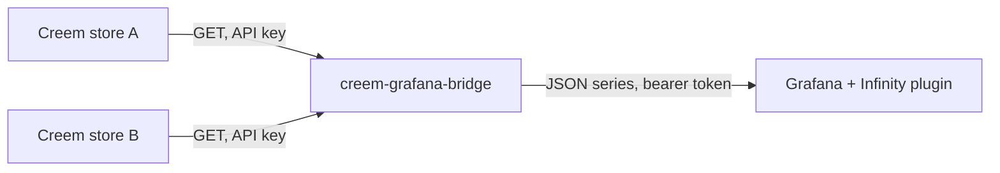

---
hide:
  - toc
---

# Your Creem stores' revenue, in Grafana

creem-grafana-bridge reads the payments and subscriptions of one or more <a href="https://creem.io">Creem</a> stores and hands Grafana ready-made series: revenue per month, cashflow, what the active subscriptions will pay, and when the money is likely to reach your bank. Before and after VAT and Creem's fee.

[Set it up](getting-started.md){ .md-button .md-button--primary } [Connect Grafana](grafana.md){ .md-button }

<small>The example dashboard (`examples/grafana/dashboards/revenue.json`) with two made-up stores.</small>

## What it does

- **Revenue and cashflow, per month.** Revenue spreads each payment over the period it pays for, so a yearly licence counts about 1/12 in each month. Cashflow puts it in the month it was paid.
- **Gross and net.** Gross is what customers paid, VAT included. Net is after VAT and Creem's fee, exact to the cent.
- **A forecast that holds with three customers.** It doesn't fit a curve: it lists what each active subscription will pay on its coming dates, after its discount, if nobody cancels.
- **Estimated payouts.** When and how much reaches your bank, from Creem's payout rules: Creem's API has no payouts.
- **Several stores.** One key per store; every series can be shown per plan, per store or in total.
- **Stores nothing.** Every answer is computed from Creem's own records (cached a few minutes). A refund corrects past months by itself, and there is no database to keep in sync.
- **Never silently wrong.** If a store can't be read, or holds something the bridge doesn't understand yet, the answer is an error naming the store, not totals that quietly leave it out.

It is a small Python service using only the standard library, published as a container image: `ghcr.io/marceltov/creem-grafana-bridge`.
